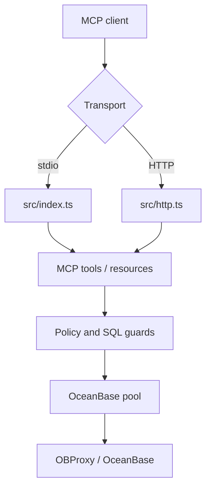

# Architecture

[中文](../zh-CN/architecture.md) | [Back](README.md)

## Components



## Runtime Paths

| Path | Use |
| --- | --- |
| `src/index.ts` | Local stdio MCP server. |
| `src/http.ts` | Streamable HTTP MCP server. |
| `src/mcp.ts` | Tool and resource registration. |
| `src/sql.ts` | SQL read-only checks and row-limit wrapping. |
| `src/policy.ts` | Schema/table/column policy. |
| `src/db.ts` | OceanBase queries and metadata access. |
| `src/er.ts` | ER diagram structure and Mermaid output. |
| `src/plan-analysis.ts` | Query-plan risk detection. |
| `src/query-generation.ts` | Read-only SQL template generation. |
| `src/performance-report.ts` | Performance advisory report assembly. |
| `src/config.ts` | Environment and profile loading. |
| `src/diagnostics.ts` | Config and deployment diagnostics. |
| `src/ip-policy.ts` | Source IP/CIDR allowlist. |
| `src/runtime.ts` | Pool lifecycle and per-profile concurrency gates. |

## Read Flow

1. The MCP client calls a tool.
2. The tool selects a profile.
3. SQL input and request limits are checked.
4. Access policy checks schema, table, and column references.
5. The query is wrapped with hard row caps where needed.
6. Database access passes through the profile concurrency gate.
7. The database execution uses a read-only transaction by default.
8. Output fields and JSON response size are checked before returning data.
9. Audit logs record request id, client id, token, tool, profile, duration, row count, and blocked reason.

## HTTP Flow

1. Host header validation.
2. Source IP allowlist.
3. Health/metrics endpoint auth according to configuration.
4. Rate limit.
5. Bearer token authentication with optional profile/tool scopes.
6. JSON body limit and parsing.
7. MCP request handling.

`/healthz` and `/metrics` are also protected by source IP allowlist when it is configured. `/metrics` requires bearer auth by default in production and non-local binds.

## Profiles

Profiles isolate connection and policy settings:

```bash
OB_PROFILES=dev,prod
OB_DEFAULT_PROFILE=dev
OB_PROFILE_PROD_HOST=your-obproxy.example.com
OB_PROFILE_PROD_USER=readonly_user@tenant#cluster
OB_PROFILE_PROD_ALLOWED_SCHEMAS=app_schema
```

Tool calls can pass `{ "profile": "prod" }`.

## Metadata Strategy

MySQL mode uses `information_schema`.

Oracle mode uses current-schema `USER_*` views when possible and falls back to `ALL_*` views for cross-schema metadata. This keeps local Oracle tenants responsive while still supporting explicit schema access.

DDL, ER, Oracle object metadata, SQL templates, and performance reports all use the same profile, access policy, concurrency, timeout, response-size, and audit path. SQL templates only generate text; performance reports only run read-only `EXPLAIN`.

## Observability

- JSON audit and error logs go to stdout/stderr.
- `GET /healthz` returns minimal readiness information and does not expose profile names by default.
- `GET /metrics` exposes Prometheus text metrics and can require bearer auth.
- `ob_config_diagnostics` exposes the same hardening checks to MCP clients.
- `ob_verify_permissions` checks database account privileges through read-only metadata queries.
