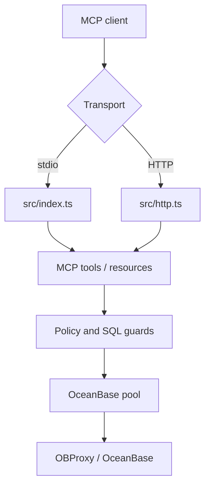

# Architecture

[中文](../zh-CN/architecture.md) | [Back](README.md)

## Components



## Runtime Paths

| Path | Use |
| --- | --- |
| `src/index.ts` | Local stdio MCP server. |
| `src/http.ts` | Streamable HTTP MCP server. |
| `src/mcp.ts` | Tool and resource registration. |
| `src/sql.ts` | SQL read-only checks and row-limit wrapping. |
| `src/policy.ts` | Schema/table/column policy. |
| `src/db.ts` | OceanBase queries and metadata access. |
| `src/config.ts` | Environment and profile loading. |
| `src/diagnostics.ts` | Config and deployment diagnostics. |
| `src/ip-policy.ts` | Source IP/CIDR allowlist. |

## Read Flow

1. The MCP client calls a tool.
2. The tool selects a profile.
3. SQL input and request limits are checked.
4. Access policy checks schema, table, and column references.
5. The query is wrapped with row caps where needed.
6. The database execution uses a read-only transaction by default.
7. Output fields are checked before returning data.
8. Audit logs record tool, profile, duration, row count, and blocked reason.

## HTTP Flow

1. Host header validation.
2. Source IP allowlist.
3. Rate limit.
4. Bearer token authentication.
5. JSON body limit and parsing.
6. MCP request handling.

`/healthz` and `/metrics` are also protected by source IP allowlist when it is configured.

## Profiles

Profiles isolate connection and policy settings:

```bash
OB_PROFILES=dev,prod
OB_DEFAULT_PROFILE=dev
OB_PROFILE_PROD_HOST=your-obproxy.example.com
OB_PROFILE_PROD_USER=readonly_user@tenant#cluster
OB_PROFILE_PROD_ALLOWED_SCHEMAS=app_schema
```

Tool calls can pass `{ "profile": "prod" }`.

## Metadata Strategy

MySQL mode uses `information_schema`.

Oracle mode uses current-schema `USER_*` views when possible and falls back to `ALL_*` views for cross-schema metadata. This keeps local Oracle tenants responsive while still supporting explicit schema access.

## Observability

- JSON audit and error logs go to stdout/stderr.
- `GET /healthz` returns readiness and profile names.
- `GET /metrics` exposes Prometheus text metrics.
- `ob_config_diagnostics` exposes the same hardening checks to MCP clients.
