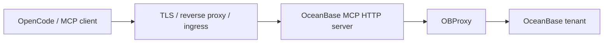

# Deployment

[中文](../zh-CN/deployment.md) | [Back](README.md)

Use Linux, Docker, or Kubernetes for server deployments. Windows is supported as a local developer client that runs Node.js and OpenCode, not as the recommended production server platform.

## Architecture



For local development, OpenCode can call the stdio server directly and skip the HTTP layer.

## Preflight

```bash
npm ci
npm run build
npm test
npm run config:doctor
npm run smoke
npm run mcp:smoke
npm run http:smoke
```

For Oracle compatibility:

```bash
npm run mcp:smoke:oracle
npm run http:smoke:oracle
```

## Docker

Build and run:

```bash
docker build -t oceanbase-mcp:latest .
docker run --rm \
  --name oceanbase-mcp \
  -p 127.0.0.1:3000:3000 \
  -e NODE_ENV=production \
  -e OB_HOST=your-obproxy.example.com \
  -e OB_PORT=2883 \
  -e OB_USER=readonly_user@tenant#cluster \
  -e OB_PASSWORD=replace-me \
  -e OB_COMPATIBILITY=mysql \
  -e OB_PRODUCTION=true \
  -e OB_MCP_READ_ONLY=true \
  -e OB_ALLOWED_SCHEMAS=app_schema \
  -e OB_ALLOW_SELECT_STAR=false \
  -e OB_ENFORCE_READ_ONLY_TX=true \
  -e OB_MAX_ROWS=100 \
  -e OB_MAX_RESULT_BYTES=1048576 \
  -e OB_MCP_AUTH_TOKEN=change-me-long-random-token-32b \
  -e OB_MCP_ALLOWED_IPS=127.0.0.1 \
  oceanbase-mcp:latest
```

Check:

```bash
curl -f http://127.0.0.1:3000/healthz
```

## Docker Compose

Use [docker-compose.yml](../../docker-compose.yml) as the starting point.

1. Edit `OB_HOST`, `OB_USER`, `OB_COMPATIBILITY`, `OB_ALLOWED_SCHEMAS`, `OB_MCP_ALLOWED_HOSTS`, and `OB_MCP_ALLOWED_IPS`.
2. Put secrets in files:

```bash
mkdir -p secrets
printf '%s' 'database-password' > secrets/ob_password
printf '%s' 'long-random-mcp-token-32b-or-longer' > secrets/ob_mcp_auth_token
```

3. Start:

```bash
docker compose up --build -d
docker compose ps
curl -f http://127.0.0.1:3000/healthz
```

The compose file binds the host port to `127.0.0.1`. Keep it that way unless a TLS reverse proxy or private network boundary is in front.

## Kubernetes

Use [deploy/kubernetes/ob-mcp.yaml](../../deploy/kubernetes/ob-mcp.yaml) as a template.

Update before applying:

- `stringData.ob_password`
- `stringData.ob_mcp_auth_token`
- `OB_HOST`
- `OB_USER`
- `OB_COMPATIBILITY`
- `OB_ALLOWED_SCHEMAS` or `OB_ALLOWED_TABLES`
- `OB_MCP_ALLOWED_HOSTS`
- `OB_MCP_ALLOWED_IPS`
- container image
- ingress host and TLS secret

Apply:

```bash
kubectl apply -f deploy/kubernetes/ob-mcp.yaml
kubectl rollout status deployment/ob-mcp
kubectl get ingress ob-mcp
```

The sample runs two replicas, drops Linux capabilities, uses a read-only root filesystem, mounts secrets read-only, and exposes `/healthz` probes.

Optional production hardening templates:

```bash
kubectl apply -f deploy/kubernetes/ob-mcp-optional.yaml
```

This file includes a `PodDisruptionBudget`, `HorizontalPodAutoscaler`, `NetworkPolicy`, and `ServiceMonitor`. Edit namespace labels, ingress controller labels, monitoring labels, and OBProxy CIDR before applying.

## Nginx Reverse Proxy

Use [deploy/nginx/ob-mcp.conf](../../deploy/nginx/ob-mcp.conf) as a starting point.

Set the MCP process:

```bash
OB_MCP_HOST=127.0.0.1
OB_MCP_PORT=3000
OB_MCP_ALLOWED_HOSTS=your-mcp.example.com
OB_MCP_ALLOWED_IPS=127.0.0.1,10.0.0.0/8
OB_MCP_TRUST_PROXY=1
```

Enable proxy trust only when Nginx is the trusted peer and clients cannot bypass it. A single Nginx hop normally uses `OB_MCP_TRUST_PROXY=1`.

## systemd

Use [deploy/systemd/ob-mcp-http.service](../../deploy/systemd/ob-mcp-http.service).

```bash
sudo useradd --system --home /opt/ob-mcp --shell /usr/sbin/nologin ob-mcp
sudo install -d -o ob-mcp -g ob-mcp /opt/ob-mcp /etc/ob-mcp /var/log/ob-mcp
sudo cp -R dist package.json package-lock.json node_modules /opt/ob-mcp/
sudo cp deploy/systemd/ob-mcp-http.service /etc/systemd/system/
sudo editor /etc/ob-mcp/ob-mcp.env
sudo systemctl daemon-reload
sudo systemctl enable --now ob-mcp-http
```

## Local Developer Client

macOS, Linux, and Windows can run the local stdio server with Node.js:

```bash
npm install
npm run build
npm run start
```

For Windows, use PowerShell to set local environment variables:

```powershell
$env:OB_HOST="127.0.0.1"
$env:OB_PORT="2883"
$env:OB_USER="ob_user@ob_mysql#obcluster"
$env:OB_PASSWORD="ob_password"
$env:OB_COMPATIBILITY="mysql"
npm run start
```

Use Windows for local development and OpenCode connectivity. For production hosting, use Linux, Docker, or Kubernetes.

## Production Checklist

- `OB_MCP_READ_ONLY=true`.
- Database account preferably has only SELECT/metadata grants.
- `OB_ALLOWED_SCHEMAS` or schema-qualified `OB_ALLOWED_TABLES` is set.
- `OB_ALLOW_SELECT_STAR=false`.
- `OB_ENFORCE_READ_ONLY_TX=true`.
- `OB_MAX_ROWS`, `OB_MAX_RESULT_BYTES`, and `OB_MAX_CONCURRENT_QUERIES` are sized for the workload.
- HTTP mode has `OB_MCP_AUTH_TOKEN` or `OB_MCP_AUTH_TOKEN_FILE`.
- Non-local bind has `OB_MCP_ALLOWED_HOSTS` and `OB_MCP_ALLOWED_IPS`.
- `OB_MCP_TRUST_PROXY` is set only behind a trusted proxy/ingress, preferably with a hop count or explicit CIDR.
- TLS is terminated at the edge.
- `ob_verify_permissions` has been run against the database account.
- Logs and metrics are collected.
- `npm test`, smoke tests, audit, and package dry-run pass before release.

## GitHub Actions Release

The repository includes:

- [.github/workflows/ci.yml](../../.github/workflows/ci.yml): build, test, audit, SBOM, npm pack dry-run, Docker build.
- [.github/workflows/release.yml](../../.github/workflows/release.yml): create tag, build npm package, generate SBOM, push multi-architecture GHCR image, build offline image archives, create GitHub Release.

Release workflow outputs:

- `ghcr.io/sevoniva/oceanbase-mcp:vX.Y.Z`
- `ghcr.io/sevoniva/oceanbase-mcp:X.Y.Z`
- `ghcr.io/sevoniva/oceanbase-mcp:latest`
- `oceanbase-mcp-X.Y.Z-amd64.tar.gz`
- `oceanbase-mcp-X.Y.Z-arm64.tar.gz`
- `ob-mcp-X.Y.Z.tgz`
- `sbom.cdx.json`

Manual release:

1. Open GitHub Actions.
2. Run `Release`.
3. Enter a version such as `v0.5.0`.
4. The workflow creates the tag, publishes images, and attaches release assets.

Load an offline image:

```bash
gunzip oceanbase-mcp-0.5.0-amd64.tar.gz
docker load -i oceanbase-mcp-0.5.0-amd64.tar
docker run --rm oceanbase-mcp:0.5.0-amd64
```
