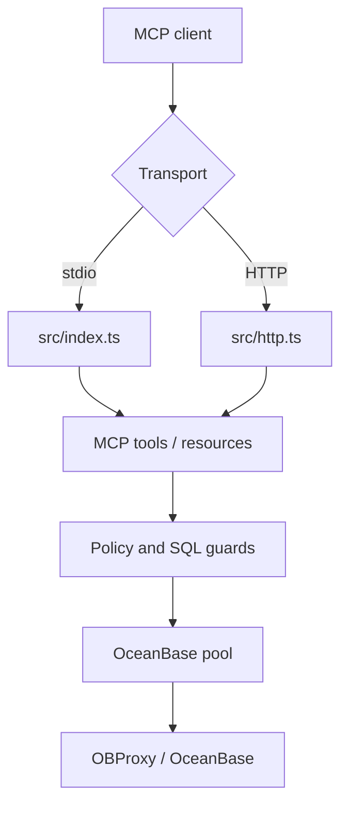

# 架构说明

[English](../en/architecture.md) | [返回](README.md)

## 组件



## 运行路径

| 路径 | 用途 |
| --- | --- |
| `src/index.ts` | 本地 stdio MCP server。 |
| `src/http.ts` | Streamable HTTP MCP server。 |
| `src/mcp.ts` | 注册工具和资源。 |
| `src/sql.ts` | SQL 只读检查和行数限制包装。 |
| `src/policy.ts` | schema/table/column 策略。 |
| `src/db.ts` | OceanBase 查询和元数据访问。 |
| `src/config.ts` | 环境变量和 profile 加载。 |
| `src/diagnostics.ts` | 配置和部署诊断。 |
| `src/ip-policy.ts` | 来源 IP/CIDR allowlist。 |

## 读取流程

1. MCP client 调用工具。
2. 工具选择 profile。
3. 检查 SQL 输入和请求限制。
4. 访问策略检查 schema、table、column 引用。
5. 必要时包装行数上限。
6. 数据库执行默认使用只读事务。
7. 返回前检查输出字段。
8. 审计日志记录工具、profile、耗时、行数和拦截原因。

## HTTP 流程

1. Host header 校验。
2. 来源 IP allowlist。
3. 限流。
4. Bearer token 认证。
5. JSON body 限制和解析。
6. MCP 请求处理。

配置来源 IP allowlist 后，`/healthz` 和 `/metrics` 也会被同样保护。

## Profiles

profile 用于隔离连接和策略：

```bash
OB_PROFILES=dev,prod
OB_DEFAULT_PROFILE=dev
OB_PROFILE_PROD_HOST=your-obproxy.example.com
OB_PROFILE_PROD_USER=readonly_user@tenant#cluster
OB_PROFILE_PROD_ALLOWED_SCHEMAS=app_schema
```

工具调用可以传 `{ "profile": "prod" }`。

## 元数据策略

MySQL 模式使用 `information_schema`。

Oracle 模式优先使用当前 schema 的 `USER_*` 视图；跨 schema 元数据才回退到 `ALL_*` 视图。这样本地 Oracle tenant 响应更稳定，同时保留显式 schema 访问能力。

## 可观测性

- JSON 审计和错误日志输出到 stdout/stderr。
- `GET /healthz` 返回 readiness 和 profile 名称。
- `GET /metrics` 暴露 Prometheus 文本指标。
- `ob_config_diagnostics` 向 MCP client 暴露同样的加固检查。
