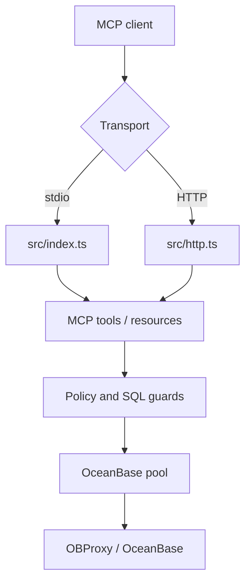

# 架构说明

[English](../en/architecture.md) | [返回](README.md)

## 组件



## 运行路径

| 路径 | 用途 |
| --- | --- |
| `src/index.ts` | 本地 stdio MCP server。 |
| `src/http.ts` | Streamable HTTP MCP server。 |
| `src/mcp.ts` | 注册工具和资源。 |
| `src/sql.ts` | SQL 只读检查和行数限制包装。 |
| `src/policy.ts` | schema/table/column 策略。 |
| `src/db.ts` | OceanBase 查询和元数据访问。 |
| `src/er.ts` | ER 图结构和 Mermaid 输出。 |
| `src/metadata-capture.ts` | 纯元数据快照采集。 |
| `src/metadata-change.ts` | 快照对比和 diff 渲染。 |
| `src/metadata-impact.ts` | 元数据 diff 和 SQL 使用影响分析。 |
| `src/metadata-report.ts` | 元数据变更报告汇总。 |
| `src/metadata-cli.ts` | 本地元数据快照、diff 和报告命令。 |
| `src/plan-analysis.ts` | 执行计划风险识别。 |
| `src/query-generation.ts` | 只读 SQL 模板生成。 |
| `src/performance-report.ts` | 性能建议报告汇总。 |
| `src/sql-scan.ts` | 静态项目 SQL 扫描和 SQL 使用索引生成。 |
| `src/sql-usage.ts` | SQL 使用查询辅助。 |
| `src/config.ts` | 环境变量和 profile 加载。 |
| `src/diagnostics.ts` | 配置和部署诊断。 |
| `src/ip-policy.ts` | 来源 IP/CIDR allowlist。 |
| `src/runtime.ts` | 连接池生命周期和每个 profile 的并发闸门。 |

## 读取流程

1. MCP client 调用工具。
2. 工具选择 profile。
3. 检查 SQL 输入和请求限制。
4. 访问策略检查 schema、table、column 引用。
5. 必要时包装行数硬上限。
6. 通过 profile 并发闸门后执行数据库访问。
7. 数据库执行默认使用只读事务。
8. 返回前检查输出字段和 JSON 大小。
9. 审计日志记录 request id、client id、token、工具、profile、耗时、行数和拦截原因。

## HTTP 流程

1. Host header 校验。
2. 来源 IP allowlist。
3. health/metrics 按配置鉴权。
4. 限流。
5. Bearer token 认证，并附带可选 profile/tool scope。
6. JSON body 限制和解析。
7. MCP 请求处理。

配置来源 IP allowlist 后，`/healthz` 和 `/metrics` 也会被同样保护。`/metrics` 在生产和非本地绑定时默认要求 Bearer token。

## Profiles

profile 用于隔离连接和策略：

```bash
OB_PROFILES=dev,prod
OB_DEFAULT_PROFILE=dev
OB_PROFILE_PROD_HOST=your-obproxy.example.com
OB_PROFILE_PROD_USER=readonly_user@tenant#cluster
OB_PROFILE_PROD_ALLOWED_SCHEMAS=app_schema
```

工具调用可以传 `{ "profile": "prod" }`。

## 元数据策略

MySQL 模式使用 `information_schema`。

Oracle 模式优先使用当前 schema 的 `USER_*` 视图；跨 schema 元数据才回退到 `ALL_*` 视图。这样本地 Oracle tenant 响应更稳定，同时保留显式 schema 访问能力。

DDL、ER、Oracle 对象元数据、SQL 模板和性能报告都走同一套 profile、访问策略、并发、超时、输出大小和审计链路。SQL 模板只生成文本；性能报告只执行只读 `EXPLAIN`。

## 元数据变更策略

元数据快照只读取 catalog 元数据，不读取样例行或业务数据值。快照采集覆盖表、字段、索引、约束、分区、关系、统计信息、注释和 Oracle 对象元数据，并带有明确的表和对象数量限制。

快照对比使用稳定 fingerprint，未变化对象可跳过深度比较。diff、影响分析和报告工具只输出证据、风险等级和评审建议，不输出可执行 DDL。

项目 SQL 影响分析使用 `ob-mcp scan-sql --index-out` 生成的静态 SQL 使用索引。扫描器只读取本地文件，不连接 OceanBase。动态 SQL 会标记为不确定，不会当成确定引用。

## 可观测性

- JSON 审计和错误日志默认输出到 stderr，也可通过 `OB_MCP_LOG_FILE` 写入 JSONL 文件。
- 进程级 `uncaughtException`、`unhandledRejection` 和 warning 会在退出前写入日志。
- 工具调用或 HTTP 请求超过 `OB_MCP_SLOW_CALL_MS` 会记录慢调用日志。
- HTTP 限流和 JSON body 错误会记录 request id 和 client id。
- `GET /healthz` 返回最小 readiness 信息，默认不暴露 profile 名称。
- `GET /metrics` 暴露 Prometheus 文本指标，可要求 Bearer token。
- `ob_config_diagnostics` 向 MCP client 暴露同样的加固检查。
- `ob_verify_permissions` 用只读元数据查询核验数据库账号权限。
