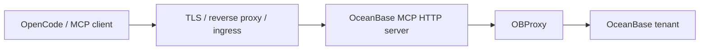

# 部署指南

[English](../en/deployment.md) | [返回](README.md)

服务端部署建议使用 Linux、Docker 或 Kubernetes。Windows 支持作为开发者本地客户端运行 Node.js 和 OpenCode，不作为推荐的生产服务器平台。

## 部署架构



本地开发时，OpenCode 可以直接调用 stdio server，不需要 HTTP 层。

## 部署前检查

```bash
npm ci
npm run build
npm test
npm run config:doctor
npm run smoke
npm run mcp:smoke
npm run http:smoke
```

Oracle 模式：

```bash
npm run mcp:smoke:oracle
npm run http:smoke:oracle
```

## Docker

构建并运行：

```bash
docker build -t oceanbase-mcp:latest .
docker run --rm \
  --name oceanbase-mcp \
  -p 127.0.0.1:3000:3000 \
  -e NODE_ENV=production \
  -e OB_HOST=your-obproxy.example.com \
  -e OB_PORT=2883 \
  -e OB_USER=readonly_user@tenant#cluster \
  -e OB_PASSWORD=replace-me \
  -e OB_COMPATIBILITY=mysql \
  -e OB_PRODUCTION=true \
  -e OB_MCP_READ_ONLY=true \
  -e OB_ALLOWED_SCHEMAS=app_schema \
  -e OB_ALLOW_SELECT_STAR=false \
  -e OB_ENFORCE_READ_ONLY_TX=true \
  -e OB_MAX_ROWS=100 \
  -e OB_MAX_RESULT_BYTES=1048576 \
  -e OB_MCP_AUTH_TOKEN=change-me-long-random-token-32b \
  -e OB_MCP_ALLOWED_IPS=127.0.0.1 \
  oceanbase-mcp:latest
```

检查：

```bash
curl -f http://127.0.0.1:3000/healthz
```

## Docker Compose

以 [docker-compose.yml](../../docker-compose.yml) 为模板。

1. 修改 `OB_HOST`、`OB_USER`、`OB_COMPATIBILITY`、`OB_ALLOWED_SCHEMAS`、`OB_MCP_ALLOWED_HOSTS`、`OB_MCP_ALLOWED_IPS`。
2. 写入 secret 文件：

```bash
mkdir -p secrets
printf '%s' 'database-password' > secrets/ob_password
printf '%s' 'long-random-mcp-token-32b-or-longer' > secrets/ob_mcp_auth_token
```

3. 启动：

```bash
docker compose up --build -d
docker compose ps
curl -f http://127.0.0.1:3000/healthz
```

示例 compose 将宿主机端口绑定到 `127.0.0.1`。除非前面有 TLS 反向代理或私有网络边界，否则不要改成公网监听。

## Kubernetes

以 [deploy/kubernetes/ob-mcp.yaml](../../deploy/kubernetes/ob-mcp.yaml) 为模板。

应用前需要修改：

- `stringData.ob_password`
- `stringData.ob_mcp_auth_token`
- `OB_HOST`
- `OB_USER`
- `OB_COMPATIBILITY`
- `OB_ALLOWED_SCHEMAS` 或 `OB_ALLOWED_TABLES`
- `OB_MCP_ALLOWED_HOSTS`
- `OB_MCP_ALLOWED_IPS`
- 容器镜像
- Ingress 域名和 TLS secret

应用：

```bash
kubectl apply -f deploy/kubernetes/ob-mcp.yaml
kubectl rollout status deployment/ob-mcp
kubectl get ingress ob-mcp
```

示例使用 2 个副本，drop Linux capabilities，启用只读根文件系统，以只读方式挂载 secret，并配置 `/healthz` 探针。

可选生产增强模板：

```bash
kubectl apply -f deploy/kubernetes/ob-mcp-optional.yaml
```

该模板包含 `PodDisruptionBudget`、`HorizontalPodAutoscaler`、`NetworkPolicy` 和 `ServiceMonitor`。应用前必须按实际 namespace、Ingress Controller、监控系统和 OBProxy 网段调整。

## Nginx 反向代理

以 [deploy/nginx/ob-mcp.conf](../../deploy/nginx/ob-mcp.conf) 为模板。

MCP 进程配置：

```bash
OB_MCP_HOST=127.0.0.1
OB_MCP_PORT=3000
OB_MCP_ALLOWED_HOSTS=your-mcp.example.com
OB_MCP_ALLOWED_IPS=127.0.0.1,10.0.0.0/8
OB_MCP_TRUST_PROXY=1
```

只有 Nginx 是可信入口，且客户端不能绕过 Nginx 访问 MCP 服务时，才启用代理信任。单层 Nginx 通常使用 `OB_MCP_TRUST_PROXY=1`。

## systemd

使用 [deploy/systemd/ob-mcp-http.service](../../deploy/systemd/ob-mcp-http.service)。

```bash
sudo useradd --system --home /opt/ob-mcp --shell /usr/sbin/nologin ob-mcp
sudo install -d -o ob-mcp -g ob-mcp /opt/ob-mcp /etc/ob-mcp /var/log/ob-mcp
sudo cp -R dist package.json package-lock.json node_modules /opt/ob-mcp/
sudo cp deploy/systemd/ob-mcp-http.service /etc/systemd/system/
sudo editor /etc/ob-mcp/ob-mcp.env
sudo systemctl daemon-reload
sudo systemctl enable --now ob-mcp-http
```

## 本地开发客户端

macOS、Linux 和 Windows 都可以用 Node.js 运行本地 stdio server：

```bash
npm install
npm run build
npm run start
```

Windows 使用 PowerShell 设置本地环境变量：

```powershell
$env:OB_HOST="127.0.0.1"
$env:OB_PORT="2883"
$env:OB_USER="ob_user@ob_mysql#obcluster"
$env:OB_PASSWORD="ob_password"
$env:OB_COMPATIBILITY="mysql"
npm run start
```

Windows 仅作为本地开发和 OpenCode 连接场景。生产承载建议使用 Linux、Docker 或 Kubernetes。

## 生产检查清单

- `OB_MCP_READ_ONLY=true`。
- 数据库账号最好只有 SELECT/元数据权限。
- 已设置 `OB_ALLOWED_SCHEMAS` 或 schema-qualified `OB_ALLOWED_TABLES`。
- `OB_ALLOW_SELECT_STAR=false`。
- `OB_ENFORCE_READ_ONLY_TX=true`。
- `OB_MAX_ROWS`、`OB_MAX_RESULT_BYTES`、`OB_MAX_CONCURRENT_QUERIES` 已按业务容量设定。
- HTTP 模式设置了 `OB_MCP_AUTH_TOKEN` 或 `OB_MCP_AUTH_TOKEN_FILE`。
- 非本地绑定设置了 `OB_MCP_ALLOWED_HOSTS` 和 `OB_MCP_ALLOWED_IPS`。
- 只有在可信代理/Ingress 后才设置 `OB_MCP_TRUST_PROXY`，优先使用跳数或明确 CIDR。
- 边缘入口已启用 TLS。
- 已运行 `ob_verify_permissions` 核验数据库账号权限。
- 日志和 metrics 已接入采集。
- 发布前通过 `npm test`、smoke、audit 和 pack dry-run。

## GitHub Actions 发布

仓库内置：

- [.github/workflows/ci.yml](../../.github/workflows/ci.yml)：构建、测试、审计、SBOM、npm pack dry-run、Docker build。
- [.github/workflows/release.yml](../../.github/workflows/release.yml)：创建 tag、构建 npm 包、打包源码、生成 SBOM、推送 GHCR 多架构镜像、构建离线镜像包、创建 GitHub Release。

Release workflow 产物：

- `ghcr.io/sevoniva/oceanbase-mcp:vX.Y.Z`
- `ghcr.io/sevoniva/oceanbase-mcp:X.Y.Z`
- `ghcr.io/sevoniva/oceanbase-mcp:latest`
- `oceanbase-mcp-X.Y.Z-amd64.tar.gz`
- `oceanbase-mcp-X.Y.Z-arm64.tar.gz`
- `ob-mcp-X.Y.Z.tgz`
- `ob-mcp-X.Y.Z-source.tar.gz`
- `sbom.cdx.json`

手动发布：

1. 打开 GitHub Actions。
2. 运行 `Release`。
3. 输入版本号，例如 `v1.1.1`。
4. workflow 会创建 tag、发布镜像并上传 Release 附件。

加载离线镜像：

```bash
gunzip oceanbase-mcp-1.1.1-amd64.tar.gz
docker load -i oceanbase-mcp-1.1.1-amd64.tar
docker run --rm oceanbase-mcp:1.1.1-amd64
```

内网源码编译：

```bash
tar -xzf ob-mcp-1.1.1-source.tar.gz
cd ob-mcp-1.1.1
npm ci
npm run build
npm run start
```

源码归档不包含 `node_modules` 和 `dist`。内网 npm 制品库需要能提供 `package-lock.json` 中锁定的依赖。构建完成后如需精简生产目录，可执行 `npm prune --omit=dev`。
